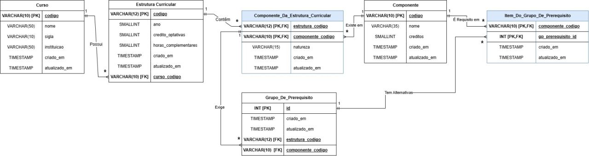

# Arquitetura

## Visão geral

```
Navegador (public/)  ──HTTP──▶  Servidor Express (server.js)  ──SQL──▶  PostgreSQL (Supabase)
   HTML, CSS, JS                   API em /api/*                        tabelas da grade
   leitura do PDF do histórico      consultas.js + db.js
```

- **Página (`public/`):** HTML, CSS e JavaScript puros, sem framework. Monta a
  pergunta como uma frase com lacunas, desenha as respostas (cadeias, fluxos e
  mapa por período) e lê o PDF do histórico do SIGAA no próprio navegador.
- **Servidor (`server.js`):** Express. Entrega a página e expõe a API. Na
  Vercel, o app é exportado e roda como função; localmente, abre a porta 3000.
- **Banco:** PostgreSQL. Em produção, no Supabase, acessado pelo
  *Transaction pooler*.

## API

| Rota | Método | Retorno |
|---|---|---|
| `/api/consultas` | GET | Perguntas disponíveis e seus campos |
| `/api/opcoes` | GET | Grades, disciplinas (com período e pré-requisitos) e cargas horárias |
| `/api/consulta` | POST | Resposta de uma pergunta: `{ tipo, parametros }` → `{ dados }` |
| `/api/status` | GET | `{ ok: true }` se o banco responde |
| `/api/sugestoes` | POST | Grava uma sugestão: `{ tipo, mensagem, nome?, email? }` |
| `/api/admin/sessao` | GET | Diz se a área admin está ativa e se há sessão |
| `/api/admin/login` | POST | Entra com `{ senha }` e recebe o cookie de sessão |
| `/api/admin/logout` | POST | Encerra a sessão |
| `/api/admin/sugestoes` | GET | Lista as sugestões (filtro `?status=`) e a contagem por situação |
| `/api/admin/sugestoes/:id` | PATCH / DELETE | Muda a situação `{ status }` ou apaga |
| `/api/admin/limpeza` | POST | Apaga as sugestões com mais de 12 meses |

As rotas `/api/admin/*` (exceto sessão e login) exigem um cookie de sessão
assinado com HMAC a partir da `ADMIN_SENHA`. Trocar a senha encerra todas as
sessões. O cookie é HttpOnly e SameSite=Strict e vale 8 horas.

Todas as consultas usam parâmetros (`$1`, `$2`…), nunca concatenação de texto,
o que protege contra injeção de SQL.

## Modelo de dados



| Tabela | Conteúdo |
|---|---|
| `curso` | Curso (código, nome, sigla, instituição) |
| `estrutura_curricular` | Cada grade (2015, 2019): ano, créditos optativos, horas complementares |
| `componente` | Catálogo único de disciplinas (código, nome, créditos, **ementa**) |
| `componente_da_estrutura_curricular` | Quais disciplinas estão em cada grade, com natureza e **período** |
| `grupo_de_prerequisito` | Exigências de uma disciplina numa grade |
| `item_do_grupo_de_prerequisito` | Alternativas de cada exigência |
| `sugestao` | Mensagens enviadas pela aba Sugestões (tipo, texto, nome e e-mail opcionais, status) |

**Regra dos pré-requisitos:** grupos diferentes da mesma disciplina valem como
**E**; itens dentro do mesmo grupo valem como **OU**. Exemplo: Arquitetura de
Software exige *um* grupo com três itens (basta uma das três disciplinas).

**Carga horária e faltas:** não ficam no banco, são calculadas a partir dos
créditos. Na UFRN, 1 crédito equivale a 15 h, as aulas têm 50 minutos e a
presença mínima é de 75%. Assim, o limite de faltas é `horas × 0,3`
(arredondado para baixo): 30 h → 9, 45 h → 13, 60 h → 18, 90 h → 27.

**Ementas:** vêm do Projeto Pedagógico do Curso (PPC) do TADS, estrutura
2019, com as alterações aprovadas depois (curricularização da extensão e a
nova ementa de Fundamentos da Computação). Disciplinas só da estrutura 2015
que não constam no PPC ficam sem ementa.

A coluna `periodo` foi acrescentada depois do diagrama acima, na tabela
`componente_da_estrutura_curricular`, porque a mesma disciplina pode estar em
períodos diferentes em cada grade.

**Segurança no Supabase:** todas as tabelas têm RLS ativado e nenhuma política,
então a API pública do Supabase não lê nem altera os dados. O servidor acessa o
banco diretamente com o usuário do PostgreSQL.

## Arquivos

| Arquivo | Função |
|---|---|
| `server.js` | Rotas da API e entrega da página |
| `consultas.js` | Consultas SQL e formatação das respostas |
| `db.js` | Pool de conexões com o PostgreSQL |
| `admin.js` | Login e rotas da área `/admin` |
| `public/admin/` | Página da área administrativa |
| `config.js` | Leitura das variáveis de ambiente (`.env`) |
| `sql/banco_completo.sql` | Criação e carga completa do banco |
| `sql/atualizacao_sugestoes.sql` | Atualização de um banco existente: tabela de sugestões |
| `sql/atualizacao_ementas.sql` | Atualização de um banco existente: ementas e correção de créditos |
| `sql/atualizacao_optativas.sql` | Atualização de um banco existente: optativas da grade TADS 2019 |
| `public/index.html`, `app.js`, `style.css` | A página |
| `public/complementares.js` | Tabela das atividades complementares (resolução do colegiado). Para atualizar, edite este arquivo |
| `public/termos.html`, `privacidade.html` | Termos de uso e política de privacidade |
| `.github/workflows/manter-ativo.yml` | Acesso periódico que evita a pausa do Supabase gratuito |
